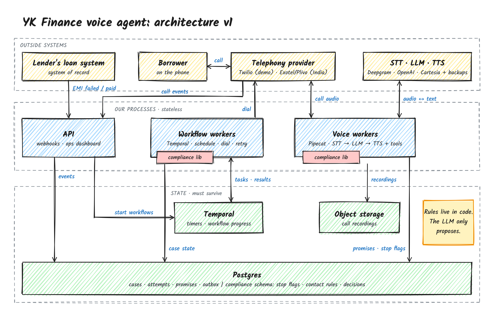

# Collections Voice Agent

A voice AI agent that calls borrowers about missed loan payments, helps them pay or make a promise to pay, and hands difficult cases to a human, while following RBI and US collection rules.

Built as a client engagement for **YK Finance**, a fictional Indian lender. The regulations, market data and sizing are real.

> Status: design, eval harness and database schema are done. The voice pipeline is in progress. See [Roadmap](#roadmap).

## The problem

YK Finance has ~800,000 active loans. Every month ~15% of EMI auto-debits bounce: **120,000 borrowers** who need a call within **48 hours**, mostly right after two collection dates. Human callers can't reach everyone in time, and they spend most of their day dialing instead of talking.

| | Value |
|---|---|
| Borrowers to reach per collection date | 60,000 in 48 h |
| Dials needed (30% reach rate, 3 attempts) | 131,400 |
| Conversations | 39,420 |
| Peak dial rate | 3.3 per second |
| Concurrent calls at peak | ~206 phone lines, ~149 AI sessions |
| Cost per conversation | ~₹9 |

Full working: [estimates](docs/engagement/estimates.md), [problem statement](docs/engagement/problem-statement.md).

## Architecture



| Part | Job | Scales on |
|---|---|---|
| **Voice workers** (Pipecat) | Live calls: speech-to-text → LLM → text-to-speech, plus tools | Concurrent calls |
| **Workflow workers** (Temporal) | Each borrower's journey: scheduling, compliance check, dialing, retries, follow-ups, SMS | Backlog |
| **API** | Events from the loan system and telephony, ops dashboard | Requests |

The three processes keep no important state, so any of them can crash, restart or run as many copies as needed. Everything that must survive lives in **Postgres** (records and a separate compliance schema), **Temporal** (timers, workflow progress) and **object storage** (recordings).

Full design: [design.md](docs/engagement/design.md).

## Key decisions

- **Rules live in code; the LLM only proposes.** `verify_identity` checks identity in code and returns pass/fail, so the model never sees the borrower's date of birth. `create_promise` rejects promises outside policy.
- **Compliance fails closed.** If calling hours, contact limits or stop-calling flags can't be checked, no call is made. Optional parts (memory, tracing) fail open.
- **Save before confirming.** A promise is written to the database before the agent says "confirmed". Side effects such as the payment-link SMS go through an outbox with idempotency keys.
- **A timeout is not a failure.** A timed-out dial may have connected, so it's checked, not blindly retried. Calling someone twice is worse than calling late.
- **Cascaded pipeline, not speech-to-speech.** The text in the middle is where every reply is checked before it's spoken.
- **Compliance is a library, not a service.** In-call checks must take milliseconds, with no network hop.

Every decision with what was rejected, the cost and the mitigation: [DECISIONS.md](DECISIONS.md).

## Evals

The agent is tested before it talks to anyone. An LLM plays the borrower across 28 scenarios, each with a known correct outcome: cooperative borrowers, partial payments, a family member who knows the borrower's details, distress, disputes, prompt injection, and US rules.

- Code checks wherever possible: outcome code, promise fields, escalations, no loan details before identity is verified, required disclosures.
- An LLM judge with yes/no questions for tone and false statements.
- Each scenario runs 3 times (pass^k); 8 scenarios are held out to catch overfitting.

**Baseline:** a naive agent with rules written only in its prompt passed about 1 in 5 scenarios. In one run it verified the borrower's wife because she knew his date of birth, then told her his overdue amount. Details: [p2-baseline.md](docs/results/p2-baseline.md), [evals.md](docs/engagement/evals.md).

## Roadmap

| Phase | Status |
|---|---|
| Problem, sizing, requirements | Done |
| Discovery: call outcomes, identity check, promise rules, compliance matrix, data model | Done |
| Eval harness and naive baseline | Done |
| Architecture, schema, CI | Done |
| Voice pipeline on a real phone line, per-stage latency | In progress |
| Compliance engine in code | Planned |
| Promises, outbox, idempotency | Planned |
| Temporal workflows | Planned |
| Policy RAG, borrower memory, latency work | Planned |
| Guardrails and human handoff | Planned |
| Observability, load and chaos tests | Planned |

## Run locally

Needs Docker and [uv](https://docs.astral.sh/uv/).

```bash
docker compose up -d            # Postgres
uv sync
uv run python -m db.migrate     # create tables
uv run pytest -q                # unit + integration tests
```

Evals need `OPENAI_API_KEY` in `.env`:

```bash
uv run python -m evals.run_evals --k 3
```

## Repository layout

```
agent/          the agent (naive baseline for now)
evals/          simulator, scenarios, checks, LLM judge, runner
db/             schema migrations
tests/          unit and integration tests
docs/
  engagement/   problem, estimates, requirements, discovery, design, evals
  results/      measured results
DECISIONS.md    decision log
```
