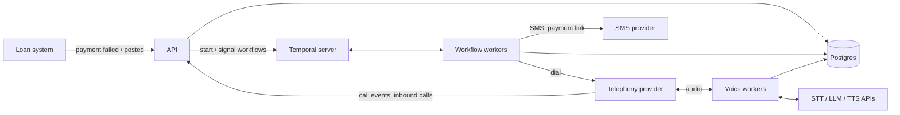

# System design (draft v0)

## 1. Three timing paths

| Path | Latency budget | Work |
|---|---|---|
| Before the call | seconds to minutes | pick accounts, compliance gate, load account and memory, warm STT/LLM/TTS connections, pre-synthesized greeting ready |
| In the turn | ~800 ms per reply | STT, LLM, TTS, plus fast tools: verify identity, in-call policy checks, record promise, set stop flag |
| After the call | seconds to days | SMS/payment link, summary and memory, case state update, promise-kept check, analytics |

Rules:
- Only STT, LLM, TTS and millisecond-scale tools run in the turn. Each tool has a timeout and a spoken fallback ("one moment").
- Reads happen before the call: account, memory and compliance state are loaded before dialing, never fetched mid-turn.
- Write synchronously, during the call, only what we confirm to the borrower or what protects them: the promise record (before saying "confirmed") and stop-contact flags. Everything else goes to a durable queue (outbox) and runs after.
- Audit records are written in the same transaction as the decision they describe, or through the outbox. Never best-effort.
- Answer latency: the greeting plays immediately on answer (pre-synthesized). Silence after "hello" makes people hang up.

## 2. Services

One codebase, one Docker image, three process types. Compliance is a library inside them, not a service.

| Process | Does | Scales on | If it crashes |
|---|---|---|---|
| Voice worker | Runs live calls: audio in, STT → LLM → TTS, in-call tools | Concurrent calls (~200 at peak) | Its live calls drop. The workflow sees no outcome, codes SYSTEM_FAILURE, retries per policy. Other workers continue. |
| Workflow worker | Per-account workflows: scheduling, pre-dial gate, dial pacing, retries, timers, promise checks, outbox side effects | Backlog of pending work | No new dials. Live calls continue. Temporal resumes every workflow where it stopped. |
| API | Webhooks from the loan system and telephony, ops dashboard | Requests per second (small) | Dashboard down. Telephony routes inbound calls to a fallback URL. Loan-system events are retried by the sender or picked up by a sync job. |

Shared infrastructure: Postgres (our data, plus the compliance store as its own schema), Temporal server. External: telephony, STT/LLM/TTS, SMS.

- Compliance as a library: in-call checks must take milliseconds, and a separate service would add a network hop and one more thing that can fail. Its availability is Postgres's availability.
- No Redis in v1. Temporal handles scheduling and rate limits, Postgres holds state. Add Redis only if a measurement shows a need.
- Postgres down: no dials (fail closed). Mid-call, a promise that cannot be saved is not confirmed; the borrower is told we will follow up by SMS, and the call is coded SYSTEM_FAILURE.
- Autoscaling metric for voice workers is concurrent calls, not CPU. Calls per worker is measured in the P13 load test, not guessed.
- v1 runs on one VM with Docker Compose. The load test measures one worker's capacity; scaling to 200 sessions is extrapolated and stated as such.

## 3. Where state lives

Programs hold only working copies. Each fact has one home and, where it changes, one writer.

| State | Home | Writer | If lost |
|---|---|---|---|
| Current call transcript | Voice worker memory (working copy); each finished turn appended to Postgres in the background | Voice worker | Crash loses the last seconds only |
| Verified in this call | Voice worker memory; the verification event goes to the audit log | Voice worker | Call is lost anyway |
| Promise to pay | Postgres (the record). Temporal holds only the timer that checks it, by promise id | Voice worker writes; workflow reads | Never acceptable: written before "confirmed" |
| Stop-contact flag | Postgres, compliance schema | Whoever hears it, immediately | Legal violation |
| Case state | Postgres | Workflow only | Wrong next action |
| "Call again tomorrow 10 AM" | Temporal durable timer; the borrower's request is recorded on the attempt row | Workflow | Missed or double call |
| Recording | Object storage (S3-compatible); Postgres keeps the key | Voice worker after the call | Audit gap (RBI: keep ≥ 6 months) |
| Borrower memory | Postgres | Post-call job | Agent is less personal (fails open) |
| Calls this week | Not stored. Counted from the attempts table when needed | n/a | n/a |

Recording volume: ~1.4 MB per 3-minute call (8 kHz, 64 kbps) × 39,420 conversations ≈ 57 GB per collection date, ~115 GB per month.

## 4. Failure handling: timeouts, retries, idempotency

| Call | Timeout | On failure | Duplicate protection |
|---|---|---|---|
| LLM, in the turn | ~1.5 s to first token | Say a filler line, retry once on a backup provider. Still nothing: say a short apology, end the call as SYSTEM_FAILURE, schedule a callback. Never leave silence. | The LLM call itself changes nothing, so retrying is safe. Tools it calls (create_promise) carry idempotency keys. |
| Dial (telephony API) | ~10 s | Do not redial immediately. The attempt row is written (status DIALING) before the request, with our attempt_id passed to the provider. Wait for status events or look the call up. No evidence after 60 s: mark CALL_FAILED; the normal retry policy dials later, through the gate again. | attempt_id links any call the provider did place back to our row. An answered call connects its audio to a voice worker by itself, carrying attempt_id. |
| Payment link + SMS | ~10 s | Retry with exponential backoff and jitter, max 5 tries, then dead-letter queue, alert ops, fall back to WhatsApp or a human. | The link is created once per promise (promise_id as the reference at the payment gateway), so a resent SMS carries the same link. The outbox job is unique per promise. |

Asymmetry for dialing: a second call seconds after the first is harassment and counts toward contact limits; a delayed call is cheap. So: check first, retry later.

## 5. Technology choices

| Part | Choice | Why |
|---|---|---|
| Voice pipeline shape | Cascaded: STT → LLM (text) → TTS | Text in the middle lets code check every reply before it is spoken, enforce tools, keep transcripts and time each stage (D-010) |
| Voice framework | Pipecat | D-009 |
| Telephony (demo) | Twilio, US number; plus a browser call option | Indian numbers need business KYC and, for lenders, a 1600-series number (D-011) |
| Telephony (production, India) | Exotel or Plivo with a 1600-series number | Pipecat has serializers for both; swapping is config plus the dial call |
| STT | Deepgram streaming (provisional); OpenAI transcription as backup | Streaming partial transcripts, low latency. Hindi quality checked in P4 |
| LLM | gpt-4.1-mini (provisional); backup on a second provider | Non-reasoning model: no thinking time before the first token. Final pick by evals (D-012) |
| TTS | Cartesia (provisional); OpenAI TTS as backup | Low time to first audio. Checked in P4 |
| Workflows | Temporal | D-008, P7 |
| Database | Postgres | D-008 |
| Recordings | S3-compatible object storage | Section 3 |
| Deployment | Local Docker Compose now; one VM in a Mumbai region with Caddy for HTTPS when hosting | D-013 |
