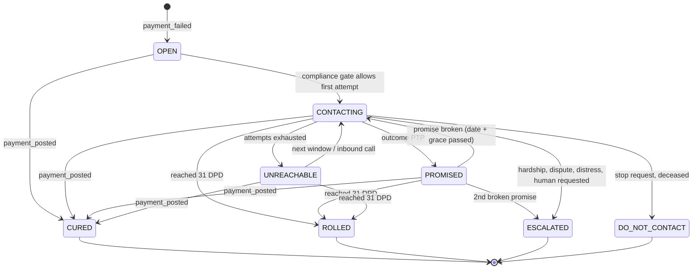
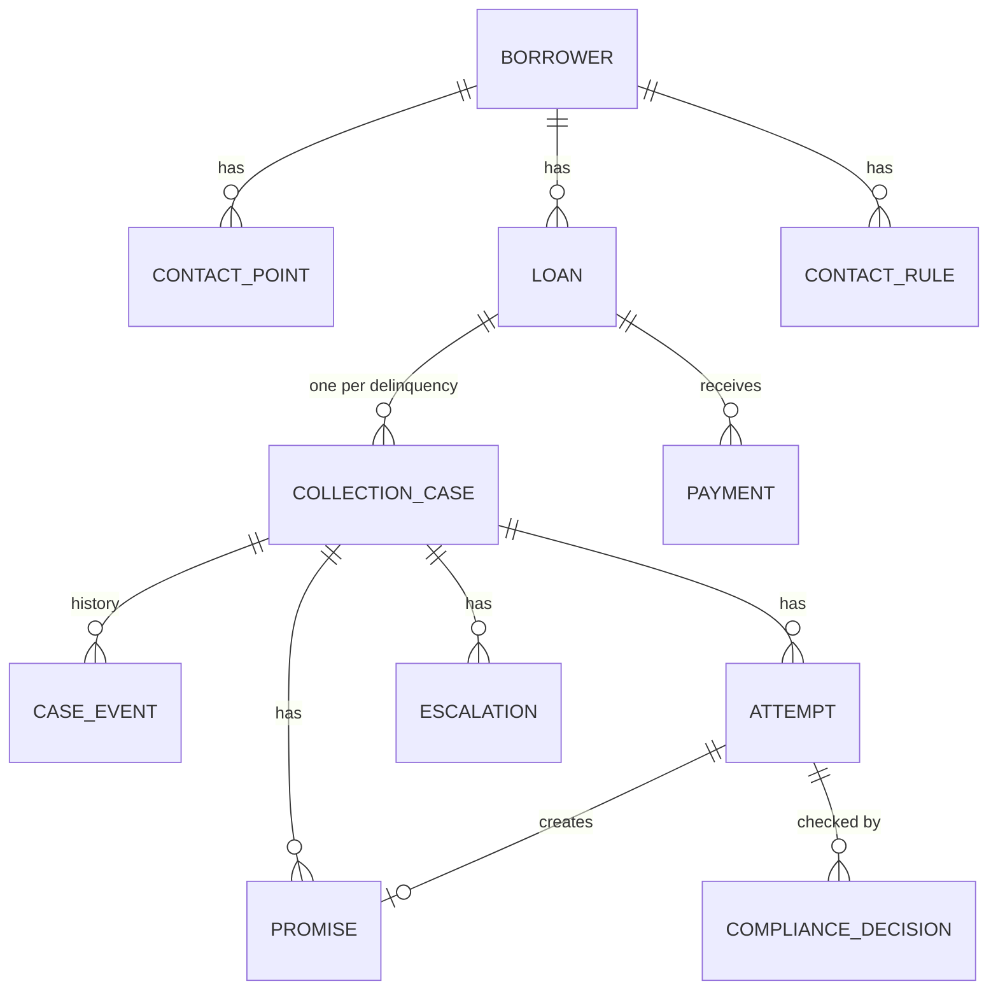

# Discovery (draft v0)

## 1. Call outcomes (disposition codes)

Every call ends with exactly one primary outcome code. Reasons and moods ("forgot", "salary late", "angry") are separate attributes on the call. They are not outcomes.

If several things happen on one call, the primary code is chosen by priority: safety, then legal/compliance, then money.

### A. Nobody spoke (set by the telephony layer)

| Code | Meaning |
|---|---|
| NO_ANSWER | Rang out |
| BUSY | Line busy or call rejected |
| UNREACHABLE | Switched off or out of coverage (network announcement) |
| INVALID_NUMBER | Number does not exist or is disconnected |
| VOICEMAIL | Answering machine (rare on Indian mobiles, common in the US) |
| CALL_FAILED | Carrier or our own error before connect |

### B. Someone answered, not a verified borrower

| Code | Meaning |
|---|---|
| THIRD_PARTY | Knows the borrower (family, friend, colleague) |
| WRONG_NUMBER | Does not know the borrower (often a reassigned number) |
| DECEASED_REPORTED | Caller says the borrower has died |
| NOT_VERIFIED | Claims to be the borrower but fails or refuses the identity check |

### C. Verified borrower (right-party contact)

| Code | Meaning |
|---|---|
| PAID_ON_CALL | Paid through the link during the call |
| CLAIMS_PAID | Says they already paid; needs a check against payment records |
| PTP | Promise to pay: amount (full or partial), date, method |
| CALLBACK_REQUESTED | Asks to be called at a specific time |
| REFUSED | Will not pay; reason recorded |
| DISPUTE | Amount wrong, not my loan, fraud or identity theft |
| HARDSHIP | Job loss, medical, disaster; goes to a human |
| STOP_CONTACT | Asks us to stop calling, or to use another channel only |
| HUMAN_REQUESTED | Asks for a person |
| COMPLAINT | Complaint about the lender or past calls |
| LEGAL | US: has a lawyer, or filed for bankruptcy |
| LANGUAGE_UNSUPPORTED | Cannot continue in Hindi or English |
| DISTRESS | Mentions self-harm or crisis; safe-handling script and immediate human |

### D. Ended before an outcome

| Code | Meaning |
|---|---|
| HUNG_UP | Borrower ended the call; record the stage it happened at |
| ENDED_ABUSIVE | Agent ended politely after warnings |
| DROPPED | Network dropped the call |
| SYSTEM_FAILURE | Our STT, LLM, TTS or tools failed |

Next actions, compliance effects and metrics for each code: to be filled in.

## 2. Someone other than the borrower answers

Rules on the call:
- Before identity is verified, say nothing about the loan, the amount, missed payments or that this is about collections. This holds even if they ask, or say they are family.
- Allowed: the agent's name, that it is an AI agent, the borrower's first name, and a neutral callback request ("please ask Rahul to call us back on this number").
- Do not question them about the borrower beyond a best time to reach him. US: a collector may only confirm the borrower's home address, phone or workplace (FDCPA §804). India: RBI rules forbid intruding on the privacy of the borrower's family, referees and friends.
- If they say the borrower has died, express condolences, end the call, and stop all calls.

What the system does next:

| Outcome | Next action |
|---|---|
| THIRD_PARTY | Retry the borrower at another time (prefer the time the third party suggested). Counts as a contact attempt. Do not call to speak with the same third party again. |
| WRONG_NUMBER | Mark the number bad and never dial it again. Send the account to ops to find a new number. US: check the FCC Reassigned Numbers Database before dialing. |
| DECEASED_REPORTED | Stop all contact on every channel. Send to a human team. Never ask for proof on the call. |

## 3. Identity verification

Threat: a household member who knows the borrower's details and has the phone. No phone check can stop this fully. We limit the harm by limiting what a verified caller can do.

Outbound (we dialed the registered number, so phone possession is already one factor):
- Ask for two of: date of birth, PIN code, last 4 digits of the loan number.
- The person states the value. The agent never reads a value out ("is your birthday 5 May?" leaks it).
- The check runs in code: the LLM calls `verify_identity(dob, pincode)` and gets back pass/fail. The real values never enter the prompt, so the model cannot leak them.
- Normalize speech before comparing ("fifth May ninety-two" → 1992-05-05). STT errors on numbers are the main cause of false fails.
- Max 2 tries. Do not say which field was wrong. On failure: outcome NOT_VERIFIED, then the third-party script.

Inbound: caller ID can be spoofed, so add an OTP sent to the registered number before the knowledge check.

What each level allows:

| Level | Allowed |
|---|---|
| Not verified | Third-party script only |
| Verified | Amount due, due date, promise to pay, payment link sent to the registered number only, hardship intake |
| Needs a human (v1) | Change phone or address, settlements, anything about other loans |

## 4. Promise to pay (PTP)

A PTP is a commitment by the verified borrower to pay a specific amount, by a specific date, through a specific method, confirmed back to them.

| Field | Rule (client config, defaults shown) |
|---|---|
| Amount | > 0 and ≤ total overdue. Below the full overdue amount is a partial PTP, allowed if ≥ the client minimum (default: one EMI). |
| Date | A calendar date, not a time of day. Not in the past. At most 7 days away, and before the account would reach 31 DPD. |
| Method | Payment link (UPI/card/netbanking), branch, or the next NACH re-presentation. |
| Split | Up to 2 instalments, each with its own amount and date. Total must fit the rules above. |

The conversation:
- Vague answers ("next week", "after salary") → ask for a date. "After salary" → ask the salary date.
- Out-of-policy answers ("next month") → don't just refuse. Offer a partial payment now, and if they can't, move to hardship intake.
- "I'll try" is not a PTP. Record no commitment.
- Commit moment: the agent reads back amount, date and method, and the borrower says yes. Then `create_promise` is called and an SMS confirmation goes out.
- Validation happens in the `create_promise` tool, not in the prompt. An out-of-policy promise is rejected and the agent gets the reason.

After the call:
- Kept: payment of at least the promised amount posts by the date plus a grace period (default 2 days, for posting delays).
- Broken: schedule a follow-up call. After 2 broken promises in a cycle, no new PTP from the agent; send to a human.
- Metrics: PTP rate, kept rate, amount kept vs promised.

## 5. Account journey (collection case state machine)

A collection case opens when an EMI bounces and closes in one end state. Call outcomes are events that move the case; they are not states.

| State | Meaning | Exits |
|---|---|---|
| OPEN | Bounce received, not yet called | first attempt, payment |
| CONTACTING | Attempts in progress, retries per policy | PTP, exhausted, escalate, stop, payment, 31 DPD |
| PROMISED | Active PTP | payment, broken, 31 DPD |
| UNREACHABLE | Attempts for this window used up; SMS/WhatsApp sent | next window, inbound call, payment, 31 DPD |
| CURED (end) | Full overdue paid | |
| ROLLED (end) | Reached 31 DPD; handed to the client's next-stage team | |
| ESCALATED (end for the agent) | With a human team | |
| DO_NOT_CONTACT (end) | Stop request or deceased | |

Rules:
- Events come from three sources: the loan system (payment failed, payment posted), calls (outcome codes), and timers (promise date + grace, 31 DPD).
- Every non-end state has a timer exit, so no case gets stuck.
- payment_posted can arrive in any state. If the overdue is cleared, go to CURED and cancel scheduled calls. Recheck payment status right before every dial.
- Partial payment keeps the case open with a smaller overdue.
- Only listed transitions are allowed; others are rejected and logged. Every transition is appended to the case history for audit.

## 6. Compliance matrix

The compliance gate is a function: (account, contact history, flags, jurisdiction, now) → allow/deny plus reasons. It runs at three points: before every dial, during the call (tool layer and output checks), and after the call (counters, audit). Rules are per-jurisdiction config.

Scheduling (first attempt, retry, callback) is the workflow's job. The gate re-checks every attempt, including callbacks, because a flag may have changed since the callback was booked.

### Before every dial

| Check | India (YK Finance) | US profile |
|---|---|---|
| Calling window, borrower's local time | 8 AM–7 PM (RBI, from 1 Jan 2027), or a time the borrower asked for | 8 AM–9 PM (FDCPA, TCPA) |
| Borrower asked to avoid a time | Respect it (RBI) | Inconvenient time = not allowed (FDCPA) |
| Stop-contact / cease flag | Deny | Deny |
| Frequency limit | Client cap (default 3 attempts/day) | Max 7 attempts in 7 days per debt, and none within 7 days after a conversation (Reg F). Calls with the consumer's direct consent in the last 7 days don't count. |
| Consent | Number given on the loan; service call | Prior express consent for AI-voice calls to mobiles (TCPA; FCC 2024 ruling that AI voice = artificial voice) |
| Calling number | Must be a 1600-series number for service calls (TRAI) | Registered caller ID, STIR/SHAKEN attested |
| Number status | Not marked bad | Not marked bad; checked against the FCC Reassigned Numbers Database |
| Account status | Payment not already posted; no open dispute, hardship, or escalation; no reported death | Same, plus no attorney representation or bankruptcy |
| Sensitive occasions | Avoid bereavement and calamities (RBI) | |

### On the call: must say

| | India | US |
|---|---|---|
| Who is calling | Agent name, that it is an AI agent, lender name | Same; artificial-voice calls must identify the business at the start |
| Recording | Call is recorded (RBI: recording and retention) | Call is recorded (two-party consent states) |
| After verification | Amount, due date, payment options | Same, plus "this is an attempt to collect a debt" if the collector is covered by FDCPA |

### On the call: never say

- Any loan detail before verification.
- Threats: police, arrest, legal action that is not intended, telling family or employer.
- False or misleading statements: pretending to be a lawyer or official, wrong amounts, false urgency or false credit consequences.
- Abusive, humiliating or insulting language.
- Offers outside policy: waivers, settlements, new due dates beyond the promise window.
- Claiming to be human.

### End the call or stop contact when

Stop request, distress, reported death, dispute (India: to human; US: pause until resolved), attorney or bankruptcy (US).

### After the call

Increment contact counters, start the 7-day post-conversation clock (US), write the audit record (decision, disclosures said, outcome), keep the recording per retention policy.

Sources: [RBI directions (Exotel summary)](https://exotel.com/rbi-loan-recovery-guidelines), [The Federal](https://thefederal.com/category/business/rbi-loan-recovery-recovery-agents-banks-252820), [TRAI 1600-series direction](https://www.trai.gov.in/sites/default/files/2025-11/Direction_19112025_0.pdf), [Reg F 1006.14](https://www.ecfr.gov/current/title-12/chapter-X/part-1006/subpart-B/section-1006.14), [CFPB commentary](https://www.consumerfinance.gov/rules-policy/regulations/1006/Interp-14). RBI details come from secondary sources; check the RBI circular before treating them as final.

## 7. Data model

The client's loan management system (LMS) is the system of record for borrowers, loans and payments. We keep only a copy of what calling needs, for accounts with an open case (data minimization, DPDP). Everything about contacting the borrower is ours.

| Entity | Owner | Key fields |
|---|---|---|
| borrower | LMS copy | lms_id, name, language, timezone, jurisdiction, dob/pincode hashes for verification |
| contact_point | ours | borrower, phone, status (ok/bad), consent, last_verified |
| loan | LMS copy | lms_id, borrower, emi, overdue_amount, dpd |
| payment | LMS events | external_id (unique, so a re-sent event is ignored), loan, amount, posted_at |
| collection_case | ours | loan, state, opened_at, closed_at, end_state |
| case_event | ours, append-only | case, from_state, to_state, event, at |
| attempt | ours | case, contact_point, direction, started/ended, telephony status, outcome code, reasons, recording/transcript ref |
| promise | ours | case, attempt, amount, due_date, method, status (pending/kept/broken), idempotency_key |
| escalation | ours | case, reason, summary, team, status |
| contact_rule | compliance store | borrower, stop_contact, avoid_times, channel limits, set_by, at |
| compliance_decision | compliance store, append-only | attempt, inputs, rules_version, allow/deny, reasons, at |

Later: borrower memory (P9), knowledge base chunks (P8).

## 8. Practitioner interviews

Send to 2–3 people in collections ops or lending (LinkedIn). Message:

> Hi, I'm building an open-source voice agent for early-stage loan collections (1–30 DPD). Could I ask you 5 questions over 15 minutes? I want the design to match how real teams work.

Questions:
1. What share of first bounces pays without any contact (self-cure), and within how many days?
2. How many attempts per account per day and per cycle do you allow, and at what times do people answer most?
3. How do your agents verify identity on outbound calls?
4. What makes a promise to pay acceptable (max days, partial amounts), and what is your kept rate?
5. Which calls must always go to a human?
